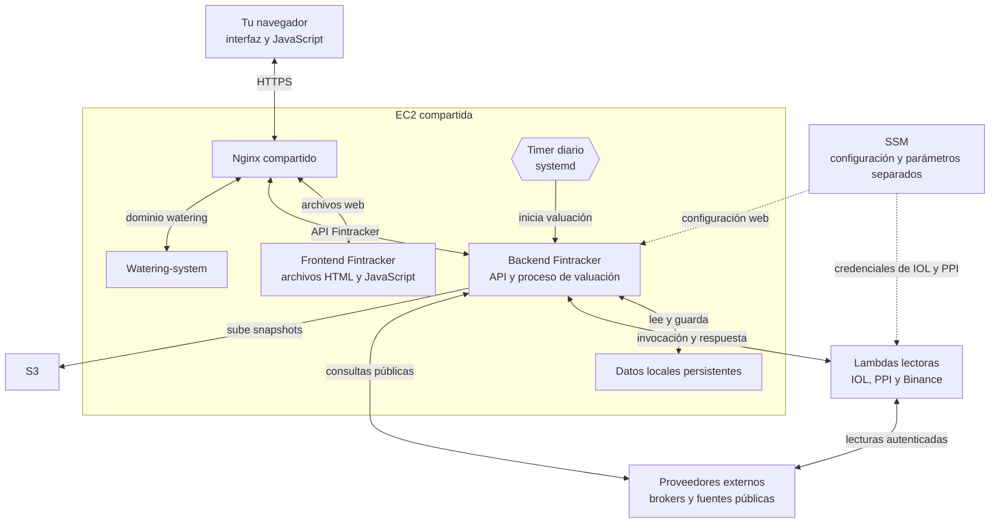

# Arquitectura de Fintracker, primera versión

La web y los cálculos de Fintracker corren en una EC2 compartida con watering-system. Los lectores de brokers corren en AWS Lambda y usan allí las credenciales de los brokers. Fintracker reúne esos datos con fuentes públicas y posiciones manuales para generar un snapshot, un resultado guardado que después consulta la interfaz.

Nginx pide los archivos al contenedor frontend y los devuelve al navegador. El JavaScript corre en el navegador y llama a la API mediante ese proxy. El dibujo agrupa la API y la valuación, que se ejecuta como un proceso separado.

## Quién hace qué

| Componente | Dónde corre | Responsabilidad | Entrada | Salida |
|---|---|---|---|---|
| Frontend | Archivos en EC2, JavaScript en tu navegador. | Mostrar cartera y trabajos. [index.html](../frontend/index.html) y [jobs.html](../frontend/jobs.html). | Acciones del usuario y respuestas JSON. | Solicitudes HTTP y pantalla. |
| Nginx | Contenedor compartido en EC2. | Dirigir cada dominio y `/api`. [nginx.conf](../nginx.conf). | Solicitud HTTPS. | Tráfico al servicio correspondiente. |
| API | Contenedor backend, Python y FastAPI. | Autenticar, consultar datos, guardar posiciones manuales e iniciar trabajos. [main.py](../backend/app/main.py). | Solicitud autenticada. | JSON o identificador de trabajo. |
| Valuación | Proceso en EC2. | Reunir fuentes y calcular resultados. [daily_snapshot.main()](../backend/core/daily_snapshot.py). | Disparador, posiciones y precios. | Snapshots y estado del trabajo. |
| Lectores | Tres Lambdas. | Autenticarse con los brokers. [broker_lambda.py](../backend/core/broker_lambda.py) las invoca. | Invocación fija. | Posiciones y precios de IOL/PPI, balances de Binance. |
| Persistencia | Disco de EC2 y S3. | Conservar manuales, historial y resultados. [storage.py](../backend/core/storage.py). | Archivos nuevos o actualizados. | Datos para próximas consultas. |
| Configuración | Parameter Store de AWS y configuración de los lectores. | Entregar configuración autorizada. [load_settings()](../backend/core/settings.py). | Identidad y nombres de parámetros. | Configuración permitida. |
| Watering-system | Sus contenedores en la misma EC2. | Atender su aplicación. | Tráfico de su dominio. | Respuestas de watering. |

## Consultar lo guardado

Al abrir la cartera o tocar **Refresh snapshot**, `loadSnapshot()` hace `GET /api/valuations/latest`. Nginx dirige la petición a la API, que lee el snapshot persistido y devuelve JSON. El navegador actualiza la pantalla con ese resultado. Esta acción vuelve a consultar lo guardado.

## Generar una valuación nueva

En Jobs, `triggerValuationJob()` hace `POST /api/jobs/valuations/run`. La API llama a [start_valuation_job()](../backend/app/job_trigger.py), inicia el proceso y devuelve su identificador. El timer de systemd también inicia el circuito de valuación en EC2. Un bloqueo compartido evita trabajos simultáneos.

`daily_snapshot.main()` consulta las Lambdas, fuentes públicas y posiciones manuales. Los `handler()` de [IOL](../backend/workers/iol.py) y [PPI](../backend/workers/ppi.py) autentican y recogen los datos. El proceso calcula, guarda snapshots y registra el trabajo. Jobs consulta su estado e historial.

## Qué se comparte y qué queda separado

El rol de ejecución de EC2 lee configuración aprobada bajo `/fintracker/web` e invoca los lectores. Sus permisos impiden recuperar las credenciales de los workers o modificar las funciones. IOL y PPI leen sus propios parámetros bajo `/fintracker/workers/...`. Binance conserva su Lambda y configuración independientes.

El [Compose aislado](../docker-compose.isolated.yml) monta los datos de Fintracker en `/app/data`. Allí persisten las posiciones manuales, el historial y los snapshots locales. Los snapshots también se suben a S3. El respaldo automático de todos los archivos manuales y del historial no forma parte de esa subida.

Watering y Fintracker comparten recursos de EC2, Nginx y la conexión del proxy con la red `watering-proxy`. El [despliegue](../scripts/deploy_isolated_web.sh) actualiza los contenedores seleccionados de Fintracker y valida y recarga el Nginx compartido. Preservar ese proxy y sus redes es necesario para mantener ambas aplicaciones disponibles.

La vista se basa en el código y el [estado verificado](../PROJECT_STATUS.md). Los detalles quedan para después.
