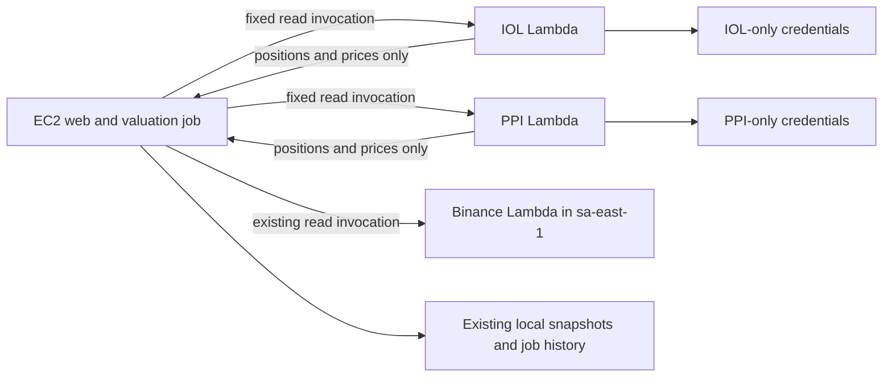

# Isolate broker credentials from the public web backend

Status: worker Lambdas are deployed and both passed a real authenticated read. The web route and its broad SSM permissions remain unchanged; credential isolation is not complete.

Last updated: 2026-10-24.

## Continuation evidence, 2026-10-24

The candidate image from build [40112620118](https://github.com/julianlizarraga15/fintracker/actions/runs/40112620118), digest `sha256:a01aa030076292246792c95219cb648b9a3df16ca8eec20d817b3226695b9be0`, upgrades installed OS packages from pinned AL2023 release `2023.12.20261021`. The image smoke check passed. The workflow initially queried ECR before scan registration and failed closed. A later live scan of this exact digest returned `COMPLETE`, no severity counts and no findings. The workflow gate and independent review passed that response. A bounded registration retry is now included. The corrected full workflow [40113111498](https://github.com/julianlizarraga15/fintracker/actions/runs/40113111498) succeeded with selected candidate `sha256:ab9bdf00f06e9d1e06dceed3acad7aa3fdd280b8cf84d1e539d2f0aee4e3e21b`, also with zero findings. See `docs/verification/20261024-broker-image.json`. Neither candidate is deployed; the currently deployed digest remains the rollback target. Basic image scanning does not establish Python dependency coverage.

All 90 backend tests passed with dotenv disabled. Live SSH confirms web `/fintracker/prod`, timer active with the container execution path and prior service exit code 0. Web CI/CD remains manually disabled. No IAM/configuration cutover or legacy credential cleanup has occurred. Local administrative AWS authentication expired and the attempted login timed out. Read-only Actions audit [40113285190](https://github.com/julianlizarraga15/fintracker/actions/runs/40113285190) confirmed the existing build identity is denied Lambda account settings, CloudFormation stack resources and IAM role reads. It could read parameter metadata. Administrative cutover remains blocked until authentication is restored; do not broaden the runtime role.

The prior prepared IAM mutation simulations used Lambda ARNs for some actions that operate on other resource types. Repeat those checks against real IAM role, ECR repository, CloudFormation stack, EC2 instance and SSM document ARNs, then simulate the actual applied role. The runbook now removes broad IAM access with the backend stopped, before the first replacement process and Refresh. Keep legacy credentials inaccessible but intact until equivalence passes.

## Prior deployment checkpoint, superseded by continuation evidence above

- PR 20 is merged at `417471ec54b1aadaf51cd793fff3cf44a700a722`. The user disabled the web `ci-cd` workflow before merging. Keep it disabled until cutover prerequisites pass.
- The manual image workflow succeeded at run `40108246784`. Current digest is `sha256:4519969d80ca9ed5fd853939ef667d4353b3ddf334d7cefe29b5bb69033faade` in the separate `fintracker-broker-sources` ECR repository. Rebuilding the unchanged Dockerfile produced the same OS vulnerability findings.
- The user copied all four worker parameters to their exact `/fintracker/workers/iol/` and `/fintracker/workers/ppi/` names. Metadata confirms each is Standard `SecureString` using `alias/aws/ssm`. Legacy copies remain for the current web route.
- The agent applied and reread the ECR retrieval policy from the runbook. It grants the Lambda service image reads restricted to the current AWS account and the two exact worker function ARNs.
- Stack `fintracker-broker-sources` is `CREATE_COMPLETE`. It contains `fintracker-fetch-iol-data` and `fintracker-fetch-ppi-data`, separate execution roles, and log groups with 14-day retention. There are no Lambda resource policies, Function URLs, or event triggers. Each worker role has one inline policy and no attached managed policy. The reviewed template grants `ssm:GetParameters` only on that broker's two exact `/fintracker/workers/...` parameters. Both functions returned successfully on live reads: IOL returned 7 positions and 7 prices; PPI returned 10 positions and 10 prices. Invocation tails were captured but not printed or independently inspected.
- **Concurrency is temporary:** applied regional Lambda concurrency is still 10. The `1001` quota request is `CASE_OPENED` and pending (case `179285424800881`). To stay within the current limit, the deployed functions have no reserved concurrency. Once the applied quota is at least 102, update the stack to reserve one concurrency per function; do not treat the open case as an applied increase.
- **Image scan:** the current digest scan completed with 12 HIGH, 20 MEDIUM, 5 LOW and 1 UNDEFINED finding, with no CRITICAL count returned. Findings include OpenSSL, RPM, PCRE2 and curl OS packages. Re-running the build did not update the base image packages or reduce the findings. This remains a hardening task before treating the worker image as clean. Basic image scanning does not establish the absence of Python dependency vulnerabilities.
- The user authorized temporary local AWS access through browser login. The selected identity was root, not a limited deployment identity. Authentication material stayed outside the repository. The agent ran `aws logout` successfully at closeout and the CLI confirmed cached login credentials were removed; already-loaded access tokens can remain valid until their 15-minute expiration. Obtain a fresh login for subsequent administrative work, preferably through a limited deployment identity. EC2 permissions were not broadened.
- Live IAM inspection found `AmazonSSMReadOnlyAccess`, `AmazonSSMManagedInstanceCore`, ECR read-only access, and an inline `/fintracker/*` policy that includes parameter writes on `fintracker-ec2-role`. Earlier identity-policy simulations confirmed broker leaf, history and ancestor-path reads plus writes are allowed. These remain confirmed isolation gaps. The EC2 role's `LambdaInvokeFunction` policy currently grants only the existing Binance function in `sa-east-1`, so the web route cannot yet call the new workers.
- Prepared replacement policy simulations allow only exact web `GetParameters` and the three approved reader invokes, deny tested broker parameter reads/history/writes and reader modifications, and preserve SSM agent channels, ECR pulls and existing S3 snapshot writes. These replacements have not been applied. Remove the managed SSM read policy, replace the agent policy without its parameter reads, and replace the wildcard parameter policy as one controlled cutover. The runbook remains the source for reproducing exact policies; temporary review artifacts are not durable context.
- Existing Binance role inspection found Lambda-only trust and its own logging grants, with no SSM grant or unqualified function resource policy. Its deployed code, key capabilities and sanitized invocation-tail behavior remain unverified.
- The startup-environment probe did not import the app or read `.env`. It confirmed the same application account, existing PPI/Binance/Ethereum/Exodus enablement, no PPI sandbox or account override, and no custom local storage paths. Manual holdings file hashes were recorded privately for later comparison. This fresh subprocess does not establish what the running web process holds in memory.
- Created 22 allowlisted web parameters as Standard `SecureString` under `/fintracker/web`, from selected existing startup environment values and exact legacy web SSM entries. Independent review checked account/auth preservation, allowlist separation and non-overwrite behavior. A real write attempt exposed an AWS CLI stdin JSON issue before any parameter was created; a synthetic CLI check reproduced it, and replayable anonymous memory input fixed it without secret arguments or persistent secret files. After creation, a readback comparison confirmed all 22 values and types matched. Only names and booleans were printed. No broker credential was requested for this preparation and `.env` was never read. The running web still uses `/fintracker/prod`.

At this prior checkpoint, the deployed old digest still needed image remediation. The continuation above completed hardening and scanning of a new candidate, which is not yet deployed. The current sequence is to restore administrative authentication, recheck applied quota, deploy the reviewed clean digest and add one reserved slot per worker if quota supports it, then perform the controlled web configuration/IAM cutover. Verify the actual web process, scheduled and manual valuation paths, manual holdings and snapshots before removing legacy broker parameters. Preserve manual holdings and snapshots throughout. The current broad web permissions mean that copying secrets alone has not secured them from the web role.

## Goal and completion criteria

Prevent a compromise of the public Fintracker backend from revealing reusable brokerage credentials or session tokens. Preserve daily valuations, authenticated Refresh, manual holdings edits, snapshots, price history, and job history.

Completion requires all of the following:

- The web process has no IOL, PPI, or Binance credential values or broker session tokens.
- The EC2 runtime identity cannot retrieve those credentials through SSM, parameter history, Lambda configuration, logs, role assumption, deployment privileges, or another permitted path.
- The web identity can invoke only the approved fixed broker read functions. It cannot change their code, configuration, roles, destinations, or deployment artifacts.
- Each broker function authenticates internally and returns a bounded, explicit data schema. Responses and invocation logs contain no credentials, authentication responses, or session tokens.
- Scheduled and manual valuations still produce equivalent positions, prices, and snapshots, including existing IOL fallbacks and PPI cash handling.
- The deployed web process is recreated after credential cleanup. Removing a parameter or permission does not clear values already held in process memory.

This protects credential values. A compromised web backend can still access the portfolio data the application displays and request permitted broker reads. It can also alter local snapshots. Preventing those actions is a stronger requirement and would justify moving the whole valuation job later.

## User constraints and working rules

- Never inspect or read `.env` contents. This applies to local files, EC2 files, and container files.
- Never print credentials, tokens, complete environment dumps, raw Lambda configuration, or broker authentication responses.
- Prefer metadata and allowlisted presence checks. An AWS CLI `--query` hides output fields but does not prevent the API client from receiving the complete response. Use metadata APIs when values are unnecessary.
- Keep production running and preserve financial behavior. Do not remove a broker's current credentials before its isolated replacement works.
- Continue authorized reversible work without repeated confirmation. Production deployment, credential deletion, and other destructive changes need concrete scope before approval.
- Use `gpt-6-luna` for focused subagent tasks and `gpt-6.1-sol` for broader tasks, per the user's latest model preference.
- Give agents bounded tasks and this plan as their starting context. Do not pass secret values to agents.

## Verified production state

The following facts were established during this session. Recheck live facts before a later deployment.

| Item | Evidence and limit |
|---|---|
| EC2 | Production runs in `us-east-1`. The existing deployment workflow identifies the instance. SSH access was verified. |
| Web runtime role | `fintracker-ec2-role`. Live identity-policy review and simulation confirm broad broker parameter reads and writes. Resource-policy and alternate-credential coverage remain incomplete. |
| Web container | `fintracker-backend`. Compose mounts host `./data` at `/app/data`. |
| SSM configuration | A targeted container environment check returned `SSM_ENV_PATH=/fintracker/prod`. `SSM_ENV_OVERRIDE` was false. |
| Parameter loading | `backend/core/settings.py` loads local environment configuration, then recursively retrieves that SSM path with decryption. `backend/core/config.py` calls `load_settings()` at import. The web app imports this configuration. |
| Broker parameter names | Metadata under `/fintracker/prod` included `PPI_PRIVATE_API_KEY`, `PPI_PUBLIC_API_KEY`, `IOL_USERNAME`, and `IOL_PASSWORD`. It also included web auth settings and `TEST_SECRET`. No values were retrieved for the audit. |
| Parameter types | PPI keys and `IOL_USERNAME` were `SecureString`. `IOL_PASSWORD` and the former Binance parameters were `String`. `String` lacks the additional `SecureString` value encryption and KMS controls; do not describe it as wholly unencrypted at rest. |
| Binance function | `fintracker-fetch-binance-balance` in `sa-east-1`. The user confirmed both Binance variables exist in its environment and its VPC section says no VPC configuration. |
| Binance execution role | Live review found Lambda-only trust and a logging-only execution policy. Deployed code, key capabilities and invocation logs remain unverified. |
| Current job duration | The last 14 recorded full valuation runs all reported success and took 10–25 seconds, mostly 11–13 seconds. This is not a Lambda benchmark or proof that every source succeeded. |
| Local tooling | SSH and a temporary AWS CLI installation are available locally. Local Docker was unavailable in WSL. EC2 has AWS CLI and Docker. Host Python on EC2 lacks `boto3`; container Python has application dependencies. |

Use the user's existing SSH identity without reading or copying its contents. Confirm the target and its known host entry through the user's local connection configuration. Public documentation does not need the server address or private-key filename.

### Binance cleanup already completed

Do not repeat these deletions.

1. The user approved deleting `/fintracker/prod/BINANCE_API_KEY` and `/fintracker/prod/BINANCE_API_SECRET`, followed by a backend restart.
2. EC2 could not delete the parameters because its role lacks `ssm:DeleteParameters`. The user executed the deletion from their AWS console identity.
3. A subsequent `DescribeParameters` metadata query found no parameter names containing `BINANCE_API` in `us-east-1`.
4. The backend container was restarted. Docker reported the new uptime, and `http://127.0.0.1:8000/openapi.json` returned HTTP 200.
5. No broker source invocation or financial comparison was run after that restart. HTTP 200 proves API startup, not Binance success or complete credential isolation.

Before deletion, container startup environment checks reported no direct Binance key, Binance secret, or PPI private key. Those checks examined a new `docker exec` process. They do not establish what the long-running web process loaded from SSM after startup, or what an application-specific dotenv load could supply.

### AWS permission limits encountered

The EC2 role returned AccessDenied for:

- `lambda:GetFunctionConfiguration` on the Binance function.
- `iam:ListAttachedRolePolicies` for both known roles.
- `ssm:DeleteParameters` for the Binance parameter copies.

These denials are useful observations, not a full least-privilege verdict. Metadata listing through `ssm:DescribeParameters` worked. Future IAM provisioning and review may require the user's console identity or a separate deployment identity. Do not broaden the EC2 runtime role merely to make investigation easier.

## Current code and behavior

| Area | Files and behavior |
|---|---|
| Configuration | `backend/core/settings.py`, `backend/core/config.py`. One shared settings object currently includes web settings and broker credentials. |
| Full valuation | `backend/core/daily_snapshot.py`. Combines IOL, PPI, Binance, wallets, public prices, and manual holdings. Saves local snapshots and optionally uploads to S3. |
| IOL | `backend/core/sources/iol.py`, `iol_client.py`, `iol_transform.py`. Logs in, fetches both portfolio markets, normalizes positions, and returns raw items plus an access token. `daily_snapshot.py` later uses that token for authenticated quote calls. |
| PPI | `backend/core/sources/ppi.py`, `ppi_client.py`, `ppi_transform.py`. Logs in, resolves the account, fetches the portfolio, and produces positions and `Price` models. Preserve cash, currency, settlement, and instrument distinctions. |
| Binance | `daily_snapshot.py::_fetch_binance_balances_from_lambda` invokes the default function in `sa-east-1`. `sources/binance.py` still contains a direct-key fallback. The invocation adapter does not check `FunctionError` and includes payload fragments in some exceptions. |
| Source result | `backend/core/sources/models.py::SourcePositions` currently combines a DataFrame with raw items, an access token, prices, and symbols. Tokens must not appear in the new remote result. |
| Public FX | `iol_client.py::get_fx_rates` uses the public dollar-rate endpoint without IOL authentication. It can stay local. |
| Scheduled job | README documents `/etc/systemd/system/valuations.service` and `.timer`. The service executes `docker exec fintracker-backend /app/scripts/run_valuations.sh` daily at 16:00 UTC. Units are not tracked in the repository. |
| Manual Refresh | `backend/app/job_trigger.py` starts a local subprocess. `POST /api/jobs/valuations/run` returns HTTP 202 with `{job, run_id, status: "started", started_at}`. Overlapping runs return HTTP 409. |
| Job history | `backend/app/job_runs.py`, `scripts/run_valuations_with_status.sh`. Read and write `data/job_runs`; include durations, source counts, pricing issues, warnings, errors, and output metadata. |
| Snapshots and prices | `backend/app/valuations.py` and `prices_history.py` read local files under `data/positions`. |
| Manual holdings | `backend/core/santander_holdings.py`, `crypto_holdings.py`, and `backend/app/manual_crypto.py`. Authenticated GET and PUT `/manual/crypto-holdings` edit local input used by later runs. |
| Deployment | `docker-compose.yml`, `backend/Dockerfile`, `.github/workflows/ci-cd.yml`. Images go to ECR; GitHub Actions deploys to EC2 through SSM. No existing IaC was found. |

## Selected approach: isolate authenticated broker reads

Keep the valuation calculation, local data, scheduler, job locks, and dashboard contracts on EC2. Move all authenticated IOL and PPI operations into separate fixed Lambda functions. This follows the useful part of the existing Binance pattern while correcting its error and logging weaknesses.

The source functions have separate execution roles. Each function chooses its own fixed account, credential references, API base URL, HTTP operations, and configuration. The caller cannot supply or override those choices. Do not return broker authentication tokens to EC2.

No new S3 snapshot storage, DynamoDB job system, coordinator, ECS cluster, second EC2 instance, or NAT Gateway is required by this approach. Validate each source's Lambda packaging, runtime, permitted deployment region, and outbound IP requirements before committing to its network configuration.

### Source contract and ownership

Use a versioned, explicit response model for normalized positions, prices, source counts, timestamps, and sanitized error codes. Derive position fields from the existing source data consumed by `daily_snapshot.py`; do not silently replace those fields with the different final `Position` model. Reuse the existing `Price` model where its JSON shape fits.

The contract must define payload and row limits, non-finite number handling, nullable values, dates, and schema rejection. Use JSON `null` for missing numeric values. Never return arbitrary broker dictionaries, SDK objects, request headers, raw error bodies, or log dumps.

Proposed organizing boundaries, with final names to settle in the first implementation unit:

- A shared Lambda invocation adapter owns AWS transport, `FunctionError` handling, payload limits, and schema parsing. It returns domain data or a sanitized source error.
- An IOL handler owns login, both portfolio-market requests, existing normalization and fallback, and all authenticated price requests. It returns positions and prices together.
- A PPI handler owns login, account resolution, SDK objects, raw portfolio data, and transformation into positions and prices.
- `daily_snapshot.py` merges returned positions and prices. It no longer imports IOL credentials, PPI keys, broker authentication objects, or bearer tokens.
- Source functions have a fixed read operation. A single well-defined empty request is preferable to a caller-controlled operation protocol.

Remove production direct-API fallback for migrated sources. An unavailable source Lambda must produce the established source failure behavior without trying credentials on EC2. Preserve how the application reports missing sources; a top-level successful job alone must not be counted as successful broker verification.

### Response and log safety

An invoker can request `LogType=Tail` in a synchronous Lambda invocation. Denying CloudWatch read access alone does not prevent the caller from receiving execution logs. Sanitize both logs and response payloads, including unexpected exceptions and SDK errors.

Treat an AWS invocation HTTP success separately from function execution success. Check `FunctionError`, validate the application response, and avoid embedding raw payload fragments in exceptions. Review the existing Binance adapter and deployed function under the same standard rather than assuming it is safe because it already runs remotely.

### IAM and configuration target

Proposed paths are design targets, not existing resources:

- `/fintracker/web`: settings needed by the web runtime, including its own authentication secrets where applicable.
- `/fintracker/workers/iol`: IOL-only settings and credentials.
- `/fintracker/workers/ppi`: PPI-only settings and credentials.

Prefer exact secret parameter reads by each source role. Store sensitive values as `SecureString` or use an existing approved secret store. Avoid introducing a dedicated paid KMS key merely by habit; document the access-control tradeoff if a customer-managed key is needed.

The web role can read its approved web configuration and invoke exact source function ARNs. Its effective permissions must exclude broker secret reads, `GetParameterHistory`, broader SSM ancestor access, worker configuration or code inspection, Lambda updates, deployment artifact modification, `iam:PassRole`, and role assumption into a more privileged identity. Review attached policies, inline policies, resource policies, boundaries, and alternate credentials. A few AccessDenied responses do not prove this boundary.

Each source role can retrieve only its own credentials and deliver sanitized logs. Keep function deployment privileges in a separate deployment identity. No source function needs a public Function URL.

The web must retain secrets required for its own authentication. The goal is broker credential isolation, not a promise that a process can use its own signing key without access to that key.

## Implementation sequence

### Preparation completed in the working tree

The implementation now includes the bounded broker contract and invocation adapter, separate IOL and PPI handlers, per-instance PPI HTTP timeouts, explicit worker configuration, and the web configuration allowlist. The web refuses raw broker credentials and the old recursive SSM prefix. The direct broker fallback is removed from the valuation path. The PPI utility also invokes the isolated source.

HTTP startup loads SSM configuration before file readers initialize. Scheduled jobs load the same approved settings before choosing their history and lock directory. A regression test runs the real scheduled shell wrapper against synthetic SSM configuration and proves that scheduled and manual locks share the configured directory.

`infra/broker-sources.yaml` defines the isolated functions and roles. `docs/broker-credential-isolation.md` is the operator runbook. The manual image workflow and PR checks build a Lambda-compatible image and run `scripts/check_broker_image.sh` with networking disabled. Local Docker integration is unavailable. GitHub CI built the actual image and passed the network-disabled smoke check, the Docker backend suite, and browser workflows in [run 40100395685](https://github.com/julianlizarraga15/fintracker/actions/runs/40100395685). CloudFormation lint passes locally. `scripts/run_tests.sh` passed all 90 tests after the reviewed fixes; existing datetime deprecation warnings remain. The first sandboxed full run stalled at TestClient, so the complete passing runs were executed outside the sandbox.

Independent review found and prompted fixes for malformed PPI data becoming successful empty portfolios, missing SDK HTTP timeouts, an outdated direct-auth utility, deployment cleanup ordering, and SSM configuration import ordering. The remaining live IAM and Binance function checks are not implied by passing code tests.

### 1. Define and verify the broker result contract

- [x] Capture existing IOL and PPI output behavior with synthetic fixtures, including IOL market fallback and authenticated quote fetching, and PPI cash and settlement cases.
- [x] Define the bounded response model and sanitized source errors.
- [x] Add focused failing pytest coverage before changing the source boundary. Include invalid schema, missing prices, non-finite values, `FunctionError`, and secret-shaped values in error responses and invocation logs.
- [x] Define source success evidence that distinguishes an empty account, a disabled source, and a failed source.

### 2. Build isolated source handlers

- [x] Implement IOL authentication and every authenticated request inside its handler. No access token or refresh token leaves the function.
- [x] Implement PPI authentication, account selection, portfolio retrieval, and transformation inside its handler.
- [x] Separate worker configuration from web configuration. Avoid importing the shared recursive web loader into handlers with unnecessary settings requirements.
- [x] Package the functions reproducibly. Verify the actual Lambda-compatible package or image with synthetic external responses and bounded HTTP timeouts.
- [x] Add infrastructure definitions for separate execution roles, fixed function names, timeouts, concurrency limits, log retention, and credential references. Do not include secret values in templates or outputs.

### 3. Integrate EC2 valuation with source functions

- [x] Implement the shared invocation adapter and the IOL and PPI source calls.
- [x] Remove the IOL token and raw authenticated-response dependency from `daily_snapshot.py` and `SourcePositions` where callers no longer need them.
- [x] Keep public FX retrieval and existing local valuation, snapshot, manual input, and job behavior.
- [x] Remove migrated direct credential fallback and unused web secret settings. Harden Binance invocation failure handling without silently changing its response contract.
- [x] Run focused source tests and `scripts/run_tests.sh` when practical. Use the existing synthetic HTTP and end-to-end workflows to verify Refresh, history, manual holdings, and dashboard behavior.

### 4. Prepare a concrete AWS change set

- [x] Identify a deployment identity that can inspect and change IAM and Lambda. Temporary root login is authorized locally; EC2 permissions were not broadened. Prefer a limited deployment identity for subsequent sessions.
- [ ] Review complete effective permissions for `fintracker-ec2-role` and the existing Binance role. Record any unverified route.
- [ ] Inventory credential names and ownership without retrieving their values. Determine whether `TEST_SECRET` is used before removing or moving it.
- [ ] Confirm source-specific location and IP restrictions. No public PPI requirement was found, but account-specific restrictions remain unverified. Binance has a read-only `apiRestrictions` endpoint, but it was not invoked.
- [x] Produce the exact function, role, parameter, web configuration, and deployment changes. Review that no function response or log can expose credentials.
- [x] The user authorized continued AWS preparation and supplied local browser authentication. Worker deployment uses the concrete reviewed change set. Destructive legacy cleanup remains gated on verified replacements and a controlled web cutover.

### 5. Cut over one broker at a time

- [x] Deploy both source functions and verify a controlled authenticated read with only success and row counts. IOL returned 7 positions and 7 prices; PPI returned 10 positions and 10 prices. Invocation tails were captured without printing their contents; `backend/workers/runtime.py` suppresses dependency stdout, stderr, and Python logging and maps source errors to fixed codes.
- [ ] Add one reserved concurrency to each function after AWS applies the pending quota increase. Current staging functions use unreserved concurrency because the regional quota is still 10.
- [ ] Switch EC2 to the isolated source and verify financial equivalence without dumping account data into chat or artifacts.
- [ ] Move or rotate the broker credentials into the isolated store. Remove duplicates and historical versions still accessible to the web identity. Confirm the new function uses the intended active credentials.
- [ ] Narrow web IAM and move its SSM loading to approved web configuration. Verify both direct parameter access and recursive ancestor-path access are denied for broker secrets.
- [ ] Clean the old host and container credential configuration without reading `.env`. Use the user's secret-management path or a narrowly scoped procedure that does not expose values.
- [ ] Recreate the web processes after cleanup. Check credential and token absence through an approved presence-only method that covers actual application initialization, not only a fresh uninitialized `docker exec` process.
- [ ] Verify the scheduled path, authenticated Refresh, job history, manual holdings edits, price history, and dashboard after each broker cutover.

### 6. Close the security check

- [ ] Using the actual web identity, verify it cannot retrieve current or historical broker credentials, inspect or update source functions, change their deployment artifacts, or acquire their roles.
- [ ] Verify each source function returns only the documented data and that `LogType=Tail` does not reveal authentication material on success or failure.
- [ ] Verify failures do not trigger direct API fallback on EC2.
- [ ] Review the existing Binance Lambda code, logs, effective permissions, and API key capabilities. Its environment-variable presence and lack of VPC do not establish complete isolation.
- [ ] Decide whether to rotate credentials because they were previously available to the public backend. No evidence of theft was established in this session.
- [ ] Record measured source runtimes and incremental AWS costs. Concurrency limits cap simultaneous runs but do not prevent repeated sequential reads by a compromised caller.

## Deployment and rollback rules

Keep the last working snapshots available throughout the cutover. Do not delete PPI or IOL credentials first and hope the replacement works.

A rollback after secret access is revoked must use the prior working source-function version or temporarily disable that source while preserving the last snapshot. Do not silently restore brokerage credentials to the public backend. Stop overlapping local valuations before a backend deployment or restart.

New worker credential copies, 22 encrypted web configuration copies and the restricted ECR retrieval policy are in place. The worker functions are deployed and tested, but no web route or IAM cutover has been deployed. Do not confuse worker readiness with credential isolation.

## Alternatives reviewed and why the scope changed

Two whole-job designs were explored before the smaller source boundary was recognized:

- A Fargate task with S3 and DynamoDB. Independent review rejected direct web `ecs:RunTask` plus `iam:PassRole`; a compromised web identity could bypass app validation and launch a command with worker privileges. Fixed application request fields do not constrain direct AWS calls.
- A fixed coordinator Lambda plus a whole-job worker Lambda. Review preferred its IAM boundary, but it still requires migrating manual inputs, local snapshots, job history, scheduling, and publication authority. It also needs explicit duplicate-delivery handling and transactional publication fencing.

Those whole-job designs solve a larger problem than credential-value isolation. A separate review of the source-level alternative recommended IOL and PPI Lambdas because authenticated requests can be isolated while the local valuation system stays intact. This is the selected next implementation path.

If future requirements include trustworthy snapshot publication despite web compromise or removing EC2-local job state, revisit the whole-job design. Upload immutable data first, then atomically commit the authoritative manifest and successful job outcome in the same transactional store as the lease fence. A DynamoDB lease check followed by an independent S3 pointer write leaves a race.

Temporary exploration artifacts exist under `/tmp/fintracker-secret-isolation/`, but this plan is the durable context. Future agents must not depend on those temporary files.

## Starting tasks for the next session

1. Read `PROJECT_STATUS.md` and re-establish administrative AWS authentication. The existing Actions identity cannot inspect quota, stack resources or IAM. Do not broaden EC2 permissions for this work.
2. Recheck effective IAM on the correct resource types, quota and deployed worker state. Review and deploy the clean candidate digest recorded in `docs/verification/20261024-broker-image.json`, preserving the prior working digest for rollback.
3. Repeat live worker and sanitized-log checks, then complete the controlled backend/IAM cutover from the runbook. Verify real Refresh, the scheduled path, snapshots, history and manual holdings without printing financial data.
4. Delete obsolete credential copies only after replacement and application independence are proven. Keep one owner for production mutations and use focused independent reviewers. Keep CI/CD disabled.

The source contract, handlers, integration, infrastructure and regression checks are implemented. Worker image hardening and its exact-digest scan are complete. The remaining gates are administrative access, worker deployment verification and the web IAM/configuration cutover. Do not introduce a whole-job storage migration as a prerequisite.

## Supporting references

- [AWS Lambda Invoke API](https://docs.aws.amazon.com/lambda/latest/api/API_Invoke.html), including `FunctionError` and invocation log tails.
- [AWS Parameter Store types](https://docs.aws.amazon.com/systems-manager/latest/userguide/what-is-a-parameter.html).
- [AWS Systems Manager data protection](https://docs.aws.amazon.com/systems-manager/latest/userguide/data-protection.html), including baseline encryption for all parameter types.
- [AWS GetParametersByPath](https://docs.aws.amazon.com/systems-manager/latest/APIReference/API_GetParametersByPath.html), including recursive ancestor-path access.
- [AWS ECS RunTask](https://docs.aws.amazon.com/AmazonECS/latest/APIReference/API_RunTask.html), including task overrides.
